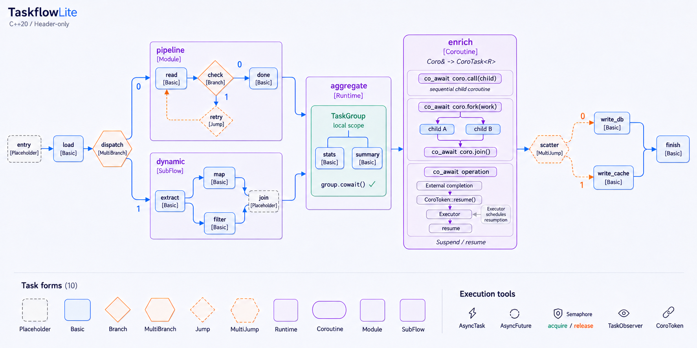
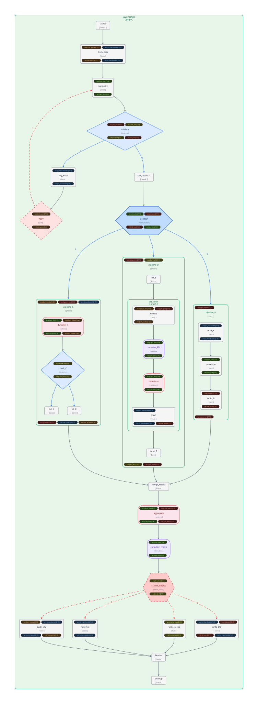

# TaskflowLite

[](https://github.com/wicyn/taskflowlite/actions/workflows/ubuntu.yml)
[](https://github.com/wicyn/taskflowlite/actions/workflows/windows.yml)
[](https://github.com/wicyn/taskflowlite/actions/workflows/macos.yml)
[](https://github.com/wicyn/taskflowlite/actions/workflows/codeql-analysis.yml)
[](https://github.com/wicyn/taskflowlite/actions/workflows/ci.yml)
[](#环境要求)
[](LICENSE)
[](#安装与集成)

**简体中文** · [English](README.en.md)

TaskflowLite（简称 tfl）是一个轻量级、仅头文件的 C++20 任务并行库，受 [Taskflow](https://github.com/taskflow/taskflow) 启发，将任务图、异步任务、协程和运行时控制流交给同一个执行器调度。

你描述任务之间的依赖，执行器负责在线程池中调度可运行的任务。它适合处理有依赖关系的计算、批处理工作流、运行期间才确定的子任务，以及需要挂起并等待外部完成通知的协程。

[快速开始](#快速开始) · [安装与集成](#安装与集成) · [核心概念](#核心概念) · [基本用法](#基本用法) · [协程](#协程任务) · [执行约定](#执行语义与使用约定) · [构建与测试](#构建与测试) · [文档与示例](#文档与示例)

[](documentation/img/taskflowlite-overview.png)

协程节点支持 `call`、`fork/join` 和通过 `CoroToken` 恢复外部等待，详见[协程指南](documentation/coroutines.md)。

## 特性

- **任务图**：构建 DAG，管理任务依赖，支持占位节点和任务重绑定。
- **异步任务**：即时提交、延迟启动、依赖编排与共享结果。
- **对象任务**：`TaskObject<T>` / `AsyncTaskObject<R, T>` 原地构造业务对象，通过 `object()` 访问状态，支持不可复制、不可移动类型。
- **协程**：`CoroTask<R>`、顺序子协程、fork/join 和外部完成令牌。
- **动态调度**：Runtime、动态 SubFlow 和作用域 TaskGroup。
- **控制流**：条件分支、多分支、跳转、重复执行和模块嵌套。
- **执行控制**：协作等待、异常传播、协作取消和信号量限流。
- **可观测性**：任务观察者、Worker 生命周期回调和 D2 图导出。
- **集成方式**：仅头文件，提供 CMake 导出目标。

## 环境要求

- C++20 编译器与标准库，支持协程、`std::format` 和原子等待等 C++20 功能。
- 使用 GCC 时需要 GCC 13 及以上版本的配套 libstdc++；Clang / MSVC 需要具备相应功能的标准库。
- CMake 3.21 或更高版本（使用 CMake 时）。

核心库不依赖第三方运行时库。测试使用 Catch2，性能对比使用 Taskflow，生成 API 文档需要 Doxygen；这些依赖仅在启用相应构建选项时使用。D2 仅用于将导出的图文本渲染为图片。

仓库配置了 Ubuntu、Windows 和 macOS 的 CI。Windows 使用 Visual Studio 2022；macOS 工作流使用 Homebrew LLVM 及其配套 libc++。具体配置以 [CI 工作流](.github/workflows) 为准，徽章显示对应工作流的运行状态。

## 快速开始

```cpp
#include <iostream>
#include <taskflowlite/taskflowlite.hpp>

int main() {
    tfl::Executor executor(4);
    tfl::Flow flow;

    const int input = 10;
    int left = 0;
    int right = 0;
    int result = 0;

    auto [A, B, C] = flow.emplace(
        [input, &left] { left = input * 2; },
        [input, &right] { right = input + 12; },
        [&left, &right, &result] { result = left + right; }
    );

    C.succeed(A, B);
    executor.async(flow).get();

    std::cout << result << '\n';  // 42
}
```

A、B 可以并行执行，C 在两者完成后执行，程序输出 `42`。`C.succeed(A, B)` 建立依赖，`executor.async(flow)` 提交图，`get()` 等待完成并传播异常。

保存为 `main.cpp`，再按下一节配置 CMake 即可构建。完整独立示例见 [01_basic_dag.cpp](examples/01_basic_dag.cpp)。

## 安装与集成

获取源码后，可选择子项目集成、安装 CMake 包或直接使用头文件：

```sh
git clone https://github.com/wicyn/taskflowlite.git
cd taskflowlite
```

### 作为 CMake 子项目

将仓库放入项目的 `external/taskflowlite` 目录，保存上面的代码为 `main.cpp`：

```cmake
cmake_minimum_required(VERSION 3.21)
project(my_app LANGUAGES CXX)

add_subdirectory(external/taskflowlite)

add_executable(my_app main.cpp)
target_link_libraries(my_app PRIVATE TaskflowLite::taskflowlite)
```

`TaskflowLite::taskflowlite` 提供头文件路径、C++20 要求和平台链接依赖。

在消费项目根目录构建：

```sh
cmake -S . -B build -DCMAKE_BUILD_TYPE=Release
cmake --build build --config Release --parallel 4
```

使用单配置生成器时运行 `build/my_app`（Windows 为 `.exe`）；Visual Studio 等多配置生成器通常输出到 `build/Release/my_app.exe`。

### 安装后使用

在 TaskflowLite 仓库根目录执行：

```bash
cmake -S . -B build/install -DTFL_BUILD_EXAMPLES=OFF -DTFL_BUILD_TESTS=OFF -DTFL_BUILD_BENCHMARKS=OFF
cmake --install build/install --prefix ./install
```

消费项目的 `CMakeLists.txt`：

```cmake
cmake_minimum_required(VERSION 3.21)
project(my_app LANGUAGES CXX)

find_package(TaskflowLite CONFIG REQUIRED)

add_executable(my_app main.cpp)
target_link_libraries(my_app PRIVATE TaskflowLite::taskflowlite)
```

在消费项目根目录配置并构建，将下面的路径替换为上一步安装目录的绝对路径：

```sh
cmake -S . -B build -DCMAKE_BUILD_TYPE=Release -DCMAKE_PREFIX_PATH=/absolute/path/to/taskflowlite/install
cmake --build build --config Release --parallel 4
```

仅安装头文件和 CMake 包时不需要先编译库。

### 直接使用头文件

将仓库中的 `taskflowlite/` 目录复制到项目的头文件目录，然后包含 `<taskflowlite/taskflowlite.hpp>`。需要自行启用 C++20 并配置线程及平台链接依赖；CMake 集成会自动处理这些设置。

## 核心概念

| 类型 | 职责 | 适用场景 |
| --- | --- | --- |
| `Executor` | 管理工作线程并调度任务 | 提交图、异步任务及等待全部任务完成 |
| `Flow` / `Task` | 拥有任务图 / 引用图中的节点 | 提前构图，配置依赖后执行；完成后可再次提交 |
| `AsyncFuture<R>` | 共享完成状态与结果 | 接收 `async()` 的结果或作为异步前驱 |
| `AsyncTask<R>` | 可配置、延迟启动的共享任务句柄 | `defer_async()` 创建，配置完成后调用 `start()` |
| `Coro` / `CoroTask<R>` | 可挂起的任务执行上下文 / 协程返回类型 | `call`、`fork/join` 和外部完成通知 |
| `CoroToken` | 当前协程等待的非拥有恢复令牌 | 外部完成源请求恢复，并查询停止状态 |
| `Runtime` | 任务执行期间的调度上下文 | 派发子任务、协作等待 |
| `SubFlow` | 任务执行期间构建的子图 | 动态构图后显式 `run()` |
| `TaskGroup` | 管理一个作用域内的子任务 | 分组等待和局部异常处理 |
| `TaskObject<T>` / `AsyncTaskObject<R, T>` | 在任务内部原地构造可调用对象 | 将业务状态与任务关联，包括不可复制、不可移动对象 |
| `Branch` / `MultiBranch` | 选择一个或多个后继 | 条件路径 |
| `Jump` / `MultiJump` | 显式跳转控制流 | 重试、状态机与循环 |
| `Semaphore` | 管理任务执行前后的资源配额 | 限制并发数、协调受限资源 |
| `Context` | `Runtime`、`SubFlow`、`Coro` 的公共执行上下文 | 查询任务信息、所属 Executor 和停止状态 |

已知完整依赖图时从 `Flow` 开始；需要直接获得一个计算结果时使用 `async()`；需要先配置再提交时使用 `defer_async()`；只有任务执行时才知道子任务内容时使用 `Runtime` 或 `SubFlow`。需要在等待子任务或外部操作时挂起当前任务，可使用 `Coro`，通过 `co_await` 交还执行权。

## 基本用法

以下 C++ 片段相互独立，均放在函数体内，使用快速开始中的头文件，并假定已创建 `tfl::Executor executor(4)`。异常示例还需包含 `<stdexcept>`。

### 异步任务与依赖

```cpp
auto left = executor.async([] { return 20; });
auto right = executor.async([] { return 22; });

auto sum = executor.async(
    [left, right] { return left.get() + right.get(); },
    left, right
);

int result = sum.get();  // 42
```

`async` 立即提交任务，返回 `AsyncFuture<R>`；callable 后面的参数指定前驱任务。Future 可复制并共享结果，`get()` 可重复调用。

异步依赖表示“前驱已经完成”，不会自动传递结果或异常。上例通过前驱的 `get()` 读取结果，同时让前驱异常传播到 `sum`。

### 延迟启动

```cpp
auto first = executor.defer_async([] { return 21; });
auto second = executor.defer_async([first] { return first.get() * 2; });

first.start();
second.start(first);

int result = second.get();  // 42
```

`defer_async()` 创建绑定当前执行器的 Idle 任务，配置后通过 `start(依赖...)` 启动一次。
前驱必须已启动或完成；支持混合 `AsyncTask` / `AsyncFuture`，空依赖忽略。
重复依赖分别登记完成计数，不持有前驱强引用；需要读取前驱结果时按值捕获 Future。执行器须在启动及执行期间保持有效。
Runtime / TaskGroup 的子任务使用各自的 `async()`；通过 `defer_async().start()` 启动的是独立顶层任务。

完整语义及依赖登记失败回滚见[异步任务依赖说明](documentation/async-task-dependency-design.md)。

### 协程任务

协程 callable 接收 `tfl::Coro&`，返回 `tfl::CoroTask<R>`。可通过 `Executor::async()` 提交、`Flow::emplace()` 构图或 Runtime / TaskGroup 派发异步任务；也支持 `emplace_object()` 和 `defer_async_object()` 对象任务接口。

```cpp
auto answer = executor.async([](tfl::Coro& coro) -> tfl::CoroTask<int> {
    const int base = co_await coro.call([](tfl::Coro&) -> tfl::CoroTask<int> {
        co_return 20;
    });

    auto child = co_await coro.fork([] { return 22; });
    co_await coro.join();
    co_return base + child.get();
});

int result = answer.get();  // 42
```

| 操作 | 等待完成后的含义 |
| --- | --- |
| `co_await coro.call(callable)` | 顺序执行子协程，取得其结果或异常；父子共享当前任务上下文 |
| `co_await coro.fork(callable, deps...)` | 子任务已提交，取得 `AsyncFuture<R>`；此时不保证子任务已完成 |
| `co_await coro.silent_fork(callable)` | 子任务已提交，不返回 Future |
| `co_await coro.join()` | 已派生子任务完成；通过对应 Future 的 `get()` 读取结果或重抛结果异常 |
| `co_await operation` | 等待符合 `CoroOperation` 协议的外部操作；完成源通过 `CoroToken::resume()` 请求恢复 |

`CoroTask<R>` 支持值、左值引用及 `void` 结果，由框架管理。子协程通过 `coro.call()` 调用；`CoroTask` 和 `AsyncFuture` 本身不提供直接 `co_await` 接口。

在协程中先 `join()` 再读取尚未完成的子任务结果；直接调用 Future 的 `wait()/get()` 会阻塞当前 Worker。派生任务若借用协程局部变量，须在这些变量销毁前显式 `join()`。同一协程可能在不同 Worker 上恢复，不要跨挂起点保存 Worker 引用或绑定 Worker 的 TaskGroup。

当前 `coro.fork()` 接收延迟任务依赖时，需要先将 `AsyncTask<R>` 转为 `AsyncFuture<R>`。外部操作的注册、取消和回调寿命也须遵守恢复协议，详见[协程指南](documentation/coroutines.md)。

完整示例：[图节点与 call](examples/40_coroutine.cpp) · [fork 依赖与 join](examples/41_coroutine_fork.cpp) · [外部恢复与停止](examples/42_coroutine_external.cpp)。

### 重复执行

```cpp
int count = 0;
tfl::Flow flow;
(void)flow.emplace([&count] { ++count; });

executor.async(flow, 5ULL).get();  // count == 5
executor.async(flow, [&count]() noexcept {
    return count >= 10;
}).get();                        // count == 10
```

次数参数指定执行轮数；终止谓词在每轮执行前检查，返回 `true` 时停止。

只需同步执行并等待时，可使用 `executor.corun(flow)`；在 Worker 内会协作推进任务。见 [corun 示例](examples/36_corun.cpp)。

### 运行时任务组

```cpp
auto future = executor.async([](tfl::Runtime& runtime) {
    tfl::TaskGroup group(runtime);

    auto left = group.async([] { return 20; });
    auto right = group.async([] { return 22; });

    group.wait();
    return left.get() + right.get();
});

int result = future.get();  // 42
```

`Runtime` 用于运行时派发任务；`TaskGroup` 管理一组子任务，`wait()` 协作等待组内任务完成。

`TaskGroup` 析构时会等待，但不会抛异常。`group.wait()` 接收归档到组的异常，例如 `silent_async()` 子任务的异常；通过 `async()` 返回的子 Future 应调用 `get()` 接收其异常，如上例所示。见 [异常处理示例](examples/16_error_handling.cpp)。

### 动态子图

```cpp
int result = 0;

auto future = executor.async([&result](tfl::SubFlow& subflow) {
    auto A = subflow.emplace([&result] { result = 21; });
    auto B = subflow.emplace([&result] { result *= 2; });

    A.precede(B);
    subflow.run();
    subflow.wait();
});

future.get();  // result == 42
```

`SubFlow` 在任务执行期间构图，通过 `run()` 提交、`wait()` 协作等待。

仅调用 `emplace()` 不会执行子图。不要将框架传入的 `Runtime&` 或 `SubFlow&` 保存到任务回调之外。

### 条件分支

```cpp
bool enabled = true;
int result = 0;
tfl::Flow flow;

auto condition = flow.emplace([enabled](tfl::Branch& branch) {
    branch.select(enabled ? 0 : 1);
});
auto yes = flow.emplace([&result] { result = 1; });
auto no = flow.emplace([&result] { result = -1; });

condition.precede(yes, no);
executor.async(flow).get();  // result == 1
```

分支索引从 0 开始，按 `precede` 的后继顺序排列。`MultiBranch` 支持选择多个后继，`Jump` / `MultiJump` 用于跳转控制流。

### 有状态的对象任务

```cpp
struct Accumulator {
    explicit Accumulator(int initial) : value(initial) {}
    Accumulator(const Accumulator&) = delete;
    Accumulator& operator=(const Accumulator&) = delete;

    int operator()() { return value += 2; }
    int value;
};

auto task = executor.defer_async_object<Accumulator>(40);
task.start();

int result = task.get();              // 42：执行结果
int state = task.object().value;      // 42：任务对象的状态
```

`object()` 访问业务对象，`get()` 访问执行结果。配置对象应在启动前完成；执行期间访问对象状态仍需自行同步。静态图中的对象任务使用 `flow.emplace_object<T>(构造参数...)`。见 [对象任务](examples/31_task_object.cpp) 和 [异步对象任务](examples/32_async_task_object.cpp)。

### 信号量限流

```cpp
tfl::Semaphore slots(2);
tfl::Flow flow;

for (int i = 0; i < 8; ++i) {
    auto task = flow.emplace([] { /* 访问受限资源 */ });
    task.acquire(slots).release(slots);
}

executor.async(flow).get();
```

即使执行器有 4 个工作线程，这些任务也最多同时运行 2 个。多配额请求使用 `acquire(sem, count)` / `release(sem, count)`。信号量必须存活到相关任务完成；acquire 的遍历顺序不保证与添加顺序相同。见 [信号量示例](examples/07_semaphore.cpp)。

### 异常处理

```cpp
auto future = executor.async([]() -> int {
    throw std::runtime_error("computation failed");
});

try {
    (void)future.get();
} catch (const std::exception& error) {
    std::cerr << error.what() << '\n';
}
```

`wait()` 仅等待完成，`get()` 还会重抛任务保存的异常。静态图中的异常通过图提交返回的 Future 接收；失败节点的依赖后继不会继续正常执行。顶层 `silent_async()` 没有结果句柄，需要在任务内部处理需报告的异常。更多情形见 [异常与依赖错误](examples/34_dependency_errors.cpp)。

库会自动检测编译器异常支持，也可通过 `TFL_ENABLE_EXCEPTIONS=0` 显式关闭。禁用异常时，库内需要抛出错误的路径会终止进程；所有翻译单元须使用一致配置。见[异常配置](cmake/README.md#异常配置)和[无异常示例](examples/37_no_exceptions.cpp)。

### 协作停止

```cpp
auto task = executor.async([](tfl::Runtime& runtime) {
    for (int i = 0; i < 1000; ++i) {
        if (runtime.stop_requested()) return;
        // 处理一个工作单元。
    }
});

task.request_stop();
task.get();
```

`request_stop()` 发出请求；长任务通过执行中的 `Context::stop_requested()` 在合适的位置检查。请求不会强制中断线程，任务也可能在请求到达前完成。

外部操作通过 `CoroToken::stop_requested()` 查询停止状态。停止请求不会自动完成 I/O，也不会唤醒正在等待外部操作的协程；适配器仍须完成或取消操作，并按协议通知恢复。见[停止示例](examples/38_context_and_stop.cpp)和[外部协程示例](examples/42_coroutine_external.cpp)。

## 执行语义与使用约定

| 主题 | 约定 |
| --- | --- |
| 图的生命周期 | 异步执行借用的图及其引用数据须存活到执行完成；`Task` 是非拥有句柄，不能在节点被删除或图销毁后使用。 |
| 图的复用 | 上次执行完成后可以再次提交；运行中不要修改图结构、任务配置或并发提交同一图。 |
| 数据同步 | 依赖边表达执行顺序。没有依赖关系的任务共享可写数据时，需要自行使用原子或锁。 |
| Future 结果 | Future 可复制，`get()` 不消费结果。值类型结果通过 `const R&` 返回，保留该引用时须确保底层任务仍存活；引用类型结果还受原始对象生命周期约束。 |
| 延迟任务 | `start()` 只允许成功启动一次；前驱必须已启动或完成。将 Idle 任务转成 Future 不会自动启动它。 |
| 依赖与资源寿命 | 动态完成依赖不保留前驱对象或结果；后继需要访问时，应按值捕获对应 Future / AsyncTask 句柄。 |
| 工作线程内等待 | 使用 `Runtime`、`SubFlow`、`TaskGroup` 的协作等待或 `co_await coro.join()`。直接阻塞等待未完成的工作可能耗尽线程池，单工作线程尤其如此。 |
| 协作取消 | `request_stop()` 发出停止请求，长任务通过 `Context::stop_requested()` 检查；不会强制中断线程，也不会撤销已经发生的副作用。 |
| 子任务停止请求 | `Runtime` / `TaskGroup` 的 `async()`、`silent_async()` 以及 Coro 的 `fork()`、`silent_fork()` 继承父停止请求。需要独立停止域时通过 `Executor` 提交。 |
| 外部恢复 | `CoroToken` 不拥有协程。外部操作须同步回调的完成/注销；`resume()` 成功只表示接受恢复请求。 |
| 任务重绑定 | 替换 callable 前先销毁旧对象；新对象构造失败时，重新绑定有效 callable 后才能执行或导出节点。 |

更详细的依赖规则、结果生命周期和失败回滚见 [异步任务依赖说明](documentation/async-task-dependency-design.md)。

## 构建与测试

以下命令在完整仓库根目录运行。默认构建示例，测试和基准默认关闭。

```sh
cmake -S . -B build -DCMAKE_BUILD_TYPE=Release
cmake --build build --config Release --parallel 4
```

默认构建不下载测试或基准依赖。运行全部示例可使用 `cmake --build build --config Release --target run_all_examples`。

单独构建协程入门示例：

```sh
cmake --build build --config Release --target tfl_ex_40_coroutine
```

单配置生成器的程序位于 `build/bin/examples/40_coroutine`；Visual Studio 通常为 `build/bin/examples/Release/40_coroutine.exe`。完整目标列表见[示例索引](examples/README.md)。

启用测试，并执行示例与单元测试：

```sh
cmake -S . -B build/tests -DCMAKE_BUILD_TYPE=Release -DTFL_BUILD_TESTS=ON
cmake --build build/tests --config Release --parallel 4
ctest --test-dir build/tests -C Release --output-on-failure -LE perfile --no-tests=error
```

`-LE perfile` 排除按文件重复注册的单元测试，与平台 CI 的运行方式一致。没有本地 Catch2 时，配置阶段会下载固定版本并校验文件；离线构建可添加 `-DTFL_CATCH2_LOCAL_PATH=/path/to/catch2/extras`。

也可使用仓库预设：

```sh
cmake --preset release
cmake --build --preset release --parallel 4
ctest --preset release -LE perfile --no-tests=error
```

`release` 预设使用 Ninja 并启用测试；Windows 使用 Visual Studio 时将三条命令中的 `release` 替换为 `windows-release`。Sanitizer 预设和 Windows ASan 运行库准备见 [构建配置](cmake/README.md)。

| 选项 | 默认值 | 说明 |
| --- | --- | --- |
| `TFL_BUILD_EXAMPLES` | 顶层 ON，子项目 OFF | 构建完整示例 |
| `TFL_BUILD_TESTS` | OFF | 构建并注册单元测试 |
| `TFL_TEST_HEADERS` | ON | 启用测试时在普通及禁用异常模式下逐头文件编译 |
| `TFL_TEST_CORE_ALLOCATION_FAILURE` | ON | 普通测试构建中运行分配失败回滚检查；Sanitizer 构建跳过，见[测试说明](test/README.md) |
| `TFL_BUILD_BENCHMARKS` | OFF | 构建 TaskflowLite / Taskflow 对比程序与 `bench_core` |
| `TFL_BUILD_DOCS` | OFF | 启用 Doxygen `GenerateDocs` 目标 |
| `TFL_SANITIZER` | OFF | `OFF`、`ASAN` 或 `TSAN`；MSVC 不支持 TSAN |
| `TFL_NATIVE_ARCH` | OFF | GCC/Clang 内部 Release 目标使用本机指令集优化 |

仅使用导出的库目标不需要下载 Catch2 或 Taskflow。依赖路径、代理和完整选项见 [构建配置](cmake/README.md)。

## 性能对比

仓库包含使用相同场景的 `bench_taskflowlite` / `bench_taskflow` 对比程序，以及覆盖执行上下文的 `bench_core`。先使用 `--smoke` 验证正确性，再在相同编译选项和机器上比较完整工作量；命令及计时范围见 [基准说明](benchmarks/README.md)。

以下数据来自历史测试，未随当前工作区重新测量。原始表未记录双方的精确提交和重复测量分布，应作为参考，不能视为当前版本或所有工作负载的性能保证。

<details>
<summary>查看历史测试环境与完整结果</summary>

历史基准测试环境：Intel Core i7-9750H @ 2.60 GHz（6 核 12 线程），Windows 11，MSVC 2022，`/O2`。

耗时单位：毫秒。加速比 = Taskflow 耗时 ÷ TaskflowLite 耗时。

| 编号 | 场景 | 线程 × 次数 | TaskflowLite（ms） | Taskflow（ms） | 加速比 |
|------|------|-------------|-------------------:|---------------:|-----------------:|
| 01 | 32 个并行任务 | 8 × 500k | 721.124 | 1231.84 | 1.71× |
| 02 | 32 个串行任务 | 1 × 1M | 616.242 | 1367.07 | 2.22× |
| 03 | 菱形 DAG | 2 × 1M | 196.331 | 362.007 | 1.84× |
| 04a | 4×2 全连接分层图 | 2 × 1M | 422.024 | 613.798 | 1.45× |
| 04b | 6×4 全连接分层图 | 4 × 500k | 1158.74 | 1710.31 | 1.48× |
| 04c | 8×8 全连接分层图 | 8 × 100k | 808.12 | 1284.82 | 1.59× |
| 04d | 8×16 全连接分层图 | 8 × 50k | 977.669 | 1727.62 | 1.77× |
| 04e | 8×32 全连接分层图 | 8 × 20k | 1062.28 | 1998.19 | 1.88× |
| 04f | 6×100 全连接分层图 | 8 × 2k | 522.272 | 885.16 | 1.69× |
| 05 | 二叉树 | 8 × 500k | 1185.87 | 3209.39 | 2.71× |
| 06 | 1→256→1 扇出与汇聚 | 8 × 100k | 2355.74 | 4114 | 1.75× |
| 07 | 16 条流水线 | 8 × 200k | 509.024 | 2511.21 | 4.93× |
| 08 | 16×16 网格 | 8 × 100k | 962.875 | 2750.96 | 2.86× |
| 09 | 稀疏 DAG | 8 × 500k | 1780.81 | 3551.17 | 1.99× |
| 10 | Jump 重试 / 条件循环 | 1 × 1M | 37.4647 | 49.0981 | 1.31× |
| 11 | MultiJump / 多条件循环 | 4 × 200k | 44.4267 | 75.4509 | 1.70× |
| 12 | 子图执行 | 4 × 200k | 103.065 | 182.91 | 1.77× |
| 13 | 子图循环 | 2 × 500k | 70.1495 | 158.994 | 2.27× |
| 14 | 空任务 | 1 × 10M | 188.495 | 624.18 | 3.31× |
| 15 | 并行 for（1024 个任务） | 8 × 10k | 505.264 | 1126.37 | 2.23× |
| 16 | 归约树（127 个节点） | 8 × 50k | 312.939 | 680.67 | 2.18× |
| 17 | 扫描链（128 个节点） | 1 × 100k | 223.374 | 498.685 | 2.23× |
| 18 | 波前图（210 个节点） | 8 × 10k | 97.2584 | 229.078 | 2.36× |
| 19 | 混合任务（18 个节点） | 8 × 100k | 721.13 | 903.111 | 1.25× |
| 20 | 内存压力（2000 个节点） | 8 × 500 | 773.992 | 1110.13 | 1.43× |
| | 几何平均 | | | | 1.97× |

`k` = 1,000，`M` = 1,000,000；10、11、13 为内部循环迭代次数，其余为图执行次数。

</details>

## 文档与示例

| 主题 | 入口 |
| --- | --- |
| 完整中文使用手册 | [当前手册](documentation/TaskflowLite-Guide.zh-CN.md) |
| 示例索引与运行方式 | [examples/README.md](examples/README.md) |
| 构建选项、依赖与安装 | [cmake/README.md](cmake/README.md) |
| 测试命令与可选诊断 | [构建与测试](#构建与测试) · [测试说明](test/README.md) |
| 异步依赖与生命周期 | [依赖说明](documentation/async-task-dependency-design.md) |
| 协程与外部操作 | [协程指南](documentation/coroutines.md) · [call](examples/40_coroutine.cpp) · [fork/join](examples/41_coroutine_fork.cpp) · [CoroToken](examples/42_coroutine_external.cpp) |
| 分支、跳转与模块 | [条件分支](examples/05_branch.cpp)、[跳转](examples/06_jump.cpp)、[嵌套模块](examples/08_subflow.cpp) |
| 动态任务 | [Runtime](examples/04_runtime.cpp)、[TaskGroup](examples/26_task_group.cpp)、[动态子图](examples/27_dynamic_subflow.cpp) |
| 执行控制 | [异常](examples/16_error_handling.cpp)、[取消](examples/17_cancellation.cpp)、[信号量](examples/07_semaphore.cpp) |
| 同步执行与无异常模式 | [corun](examples/36_corun.cpp) · [禁用异常](examples/37_no_exceptions.cpp) · [Context 与停止](examples/38_context_and_stop.cpp) |
| 观察与追踪 | [Observer](examples/15_observer.cpp)、[追踪](examples/21_observer_tracing.cpp)、[Worker 回调](examples/30_worker_handler.cpp) |
| 性能测试方法 | [benchmarks/README.md](benchmarks/README.md) |

示例中的流水线通过 `Flow` 组合实现，完整用法见 [流水线示例](examples/09_pipeline.cpp)。

安装 Doxygen 后，可生成 API 文档：

```sh
cmake -S . -B build/docs -DTFL_BUILD_EXAMPLES=OFF -DTFL_BUILD_DOCS=ON
cmake --build build/docs --target GenerateDocs
```

### 任务图可视化

通过 `flow.dump()` 导出 D2 文本，再使用 D2 渲染为 SVG。[查看完整任务图](documentation/img/d2.svg)。

<details>
<summary>展开 D2 任务图预览</summary>

[](documentation/img/d2.svg)

</details>

## 反馈与贡献

通过 [Issues](https://github.com/wicyn/taskflowlite/issues) 报告问题或提出功能建议。问题报告请包含最小复现、预期与实际行为、编译器及标准库版本、操作系统、构建选项和相关日志。

提交代码改动时请附上对应测试；公共接口变更请同步更新示例和中英文 README。提交前运行相关测试，并使用仓库的 `.clang-format` 保持代码格式一致。修改文档后可运行 `python .github/scripts/check_docs.py` 检查仓库内文件链接。

## 许可证

本项目采用 [MIT License](LICENSE)。
